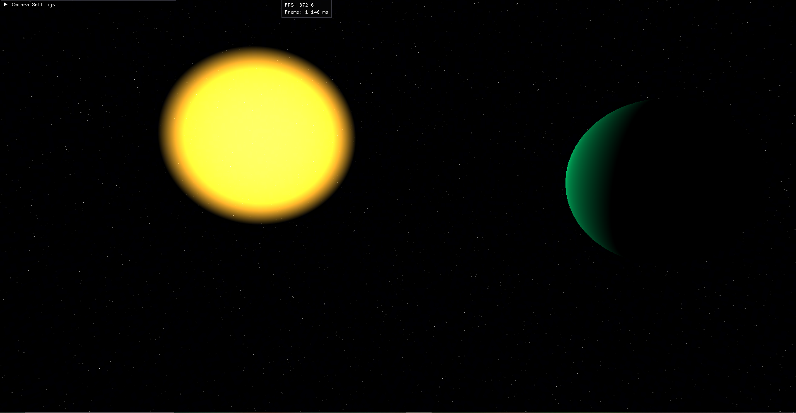

# Planet Simulation

A 3D planetary simulation engine built with C++ and OpenGL, featuring spherical planet rendering, gravity-based physics, and first-person player controls with planetary surface orientation.



## Features

### Rendering
- **Procedural Sphere Generation**: Efficient octahedron-based sphere subdivision with configurable LOD (Level of Detail)
- **Material System**: Flexible material properties with support for colors, textures, and shader uniforms
- **Skybox Rendering**: Cubemap-based skybox with procedural gradient fallback
- **Custom Shaders**: Vertex and fragment shader pipeline for planets and celestial objects
- **UV Seam Correction**: Proper texture coordinate handling for seamless sphere mapping

### Physics & Player Movement
- **Gravity System**: Radial gravity that pulls the player toward the planet center
- **Surface Collision**: Dynamic collision detection and response for planetary surfaces
- **Planetary Orientation**: Automatic player orientation aligned with the planet's surface normal
- **Movement Controls**: 
  - WASD for directional movement on the planet surface
  - Space for jumping with proper gravity consideration
  - Mouse look with yaw and pitch control
- **Camera Modes**:
  - Free camera mode for exploration
  - Player-attached mode that follows surface orientation

### Architecture
- **Component-Based Design**: Separate classes for Camera, Player, Planet, Mesh, Material, and Shader
- **MeshData Abstraction**: Decoupled mesh data from GPU representation for flexible processing
- **World Management**: Centralized World class handling scene updates and rendering
- **ImGui Integration**: Real-time parameter adjustment for camera settings and performance monitoring

## Project Structure

```
├── Camera.h/cpp          # Camera controller with free and player-attached modes
├── Player.h/cpp          # Player physics, input handling, and surface orientation
├── Planet.h/cpp          # Planet mesh generation and rendering
├── Mesh.h/cpp            # GPU mesh representation and rendering
├── MeshData.h/cpp        # CPU-side mesh data container
├── Material.h/cpp        # Material property management
├── Shader.h/cpp          # GLSL shader loading and uniform management
├── SkyBox.h/cpp          # Skybox rendering system
├── World.h/cpp           # Scene management and update loop
└── main.cpp              # Application entry point and GLFW setup
```

## Technical Implementation

### Sphere Generation Algorithm
The planet uses an octahedron subdivision approach for sphere generation:
1. Start with a base octahedron (8 triangular faces)
2. Recursively subdivide each triangle by adding midpoint vertices
3. Project vertices onto a sphere of the desired radius
4. Generate spherical UV coordinates for texture mapping
5. Handle UV seam discontinuities by duplicating vertices where needed

Higher subdivision levels exponentially increase triangle count:
- Level 0: 8 faces (octahedron)
- Level 1: 32 faces
- Level 2: 128 faces
- Level 3: 512 faces
- Level 6: ~32,768 faces

### Player Orientation System
The player maintains orientation relative to the planet surface:
- **Up Vector**: Always points away from the planet center (radial)
- **Tangent Plane Movement**: Forward/backward and left/right movement projected onto the local tangent plane
- **Camera Front**: Independent from movement direction, allowing looking up/down while moving forward
- **Coordinate Frame**: Dynamically computed local right and forward vectors based on surface normal

### Physics Simulation
- Fixed timestep physics updates for deterministic behavior
- Radial gravity force proportional to distance
- Velocity damping for realistic movement feel
- Ground detection within tolerance distance
- Normal-based velocity correction on collision

## Dependencies

- **OpenGL 3.3+**: Core graphics API
- **GLFW**: Window and input management
- **GLAD**: OpenGL function loader
- **GLM**: Mathematics library for vectors, matrices, and transformations
- **ImGui**: Immediate mode GUI for debugging and parameter tuning
- **stb_image**: Image loading for textures (included in SkyBox.cpp)

## Building the Project

```bash
# Ensure all dependencies are installed
./build_and_run.bat
```

## Controls

**Movement (Free Camera Mode)**
- `W` - Move forward
- `S` - Move backward
- `A` - Move left
- `D` - Move right
- `Space` - Move up
- `Left Shift` - Move down
- `Mouse` - Look around

**General**
- `ESC` - Toggle mouse lock/unlock

## Configuration

The simulation can be configured in `World.cpp`:
- Planet radius and position
- Sun properties (color, intensity, radius)
- Player spawn location and height
- Camera initial mode and FOV
- Material properties for planets

## Future Enhancements

Potential areas for expansion:
- Procedural terrain generation with noise-based heightmaps
- Multiple planet gravity interactions
- Orbital mechanics for planetary motion
- Atmospheric scattering effects
- Biome-based coloring system
- LOD switching based on camera distance
- Collision mesh separate from render mesh
- Planet rotation and day/night cycles

## Performance Considerations

- Sphere subdivision level 6 recommended maximum for real-time rendering
- Material uniform updates occur per draw call
- Consider frustum culling for multi-planet scenes
- LOD system implemented but not actively used in current version

---

**Note**: This simulation demonstrates fundamental concepts in 3D graphics programming, physics simulation, and game engine architecture. It serves as a foundation for more complex planetary and space simulation systems.